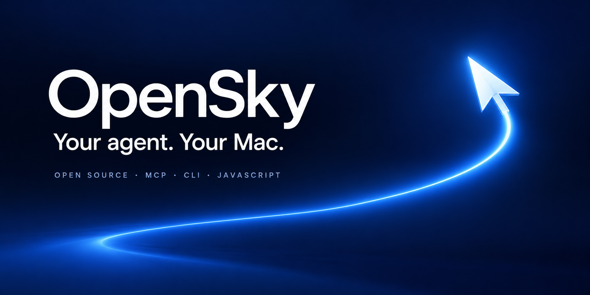
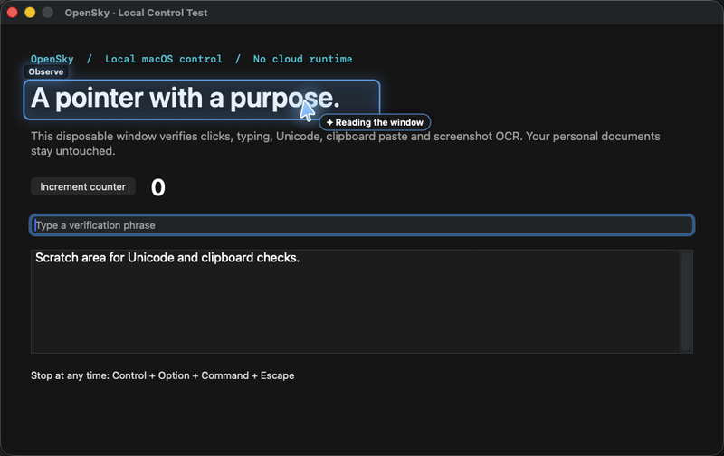
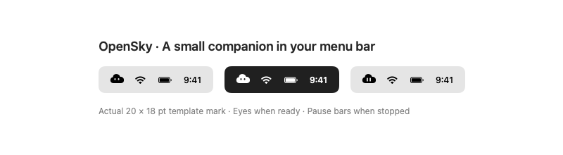

# OpenSky

## Install OpenSky + Claude

Paste this into Terminal on **macOS 14+** (Apple silicon or Intel):

```sh
curl -fsSL https://raw.githubusercontent.com/StoicEnso/opensky-computer-use/main/bootstrap.sh | bash
```

Installs the prebuilt cloud-tray app, a private Node runtime if needed, Claude Code and Claude Desktop if missing, then connects Claude and guides Mac permissions. **No Homebrew, Git, Xcode or sudo needed.** Existing Claude apps/settings and a matching OpenSky app are reused. This command currently installs the tested **1.7.0-rc.10 prerelease**.

Stay at your Mac once: approve Accessibility and Screen Recording (plus macOS event-synthesizing access if requested), sign in to Claude, and review/enable OpenSky’s Desktop extension. The guide reads back actual permissions; it never labels a pending review complete. A Mac password or Touch ID may be required **by System Settings**. OpenSky is currently ad-hoc signed, not Developer ID notarized; managed Macs/Gatekeeper policies may require owner review. The installer does not change those policies.

[Read the installer](bootstrap.sh) · [Options and resume](#one-command-options) · [Source build](#install-from-source)



**Fast, local-first browser and desktop control for your Mac.** Give your agent native app controls, on-device OCR and a visible animated pointer through MCP, the command line or JavaScript. Open source, with no built-in telemetry or OpenSky cloud relay.

[](https://github.com/StoicEnso/opensky-computer-use/actions/workflows/ci.yml)
[](https://github.com/StoicEnso/opensky-computer-use/releases/latest)
[](LICENSE)

**macOS 14+ · Apple silicon & Intel prebuilts · Private runtime · Local engine · MIT**

[Install](#install-opensky--claude) · [Connect your agent](#connect-an-agent) · [Work in the background](#work-while-you-use-the-mac) · [Privacy](PRIVACY.md) · [See test results](#tested-scope) · [Releases](https://github.com/StoicEnso/opensky-computer-use/releases)



The control engine is free and runs locally. Bring your own agent or model; its subscription or API costs are separate. OpenSky is an independent implementation built on public macOS APIs.

Let your agent follow through on the task you already authorized. OpenSky carries that workflow preference into MCP: continue within your scope and limits, use fresh observations, verify results, and avoid repeating permission questions for ordinary screens and steps. Applicable host rules and real macOS consent still apply.

Already installed? Run **`opensky onboard`** for a local setup screen that checks access, helps connect your agent and offers a verified demo. Optional Chrome Automation stays off until you choose it.

## Watch it control your Mac

After installation and permission setup, run `opensky demo`. A new disposable Mac window comes forward. OpenSky reads its controls, points at targets, clicks the counter three times, types English/Dhivehi/emoji and pastes a checklist. Each result is checked. The window stays open so you can inspect it; close it when finished.

`opensky demo --pointers-only` previews the visual effects without performing input. `opensky demo --quick` uses shorter presentation pauses. Stop at any time with **Control + Option + Command + Escape**.

## What is included

- Background Chrome tabs, page/frame snapshots, direct field entry and file uploads through OpenSky’s own extension/native-messaging bridge.
- App and window discovery; Accessibility trees with snapshot-scoped element indices.
- Window or desktop screenshots, with on-device Apple Vision text recognition.
- Clicks, typing, keys, scrolling, drags, clipboard paste, window actions, and requested AppleScript/JXA execution.
- A transparent pointer overlay with curved motion, click feedback, highlights, thinking animation, and named cursors.
- MCP over standard input/output, an agent-neutral CLI, and an importable Node.js SDK with TypeScript declarations.
- An authenticated loopback service, explicit pause/resume/shutdown, and permission diagnostics.

App support varies. Accessibility actions work best in apps that expose useful trees. Background input is best effort and some apps require focus. OCR gives text locations, not a complete semantic model of every canvas. Multiple virtual pointers do not make simultaneous keyboard or physical mouse actions safe.

## One-command options

Use `bash -s -- --no-desktop` at the end of the download command for Claude Code only; `--no-claude` installs only OpenSky. `--no-onboard` installs without opening apps/settings. `--prefix /absolute/path` and `--app-dir /absolute/path` choose destinations; `--from /absolute/release-folder` uses downloaded release archives/checksums (and the pinned Node archive when needed).

The bootstrap verifies OpenSky archive SHA-256 checksums before extraction and the app signature/API/build/architecture before replacement. Its private Node download uses a pinned official checksum. Claude Code uses Anthropic’s official installer; Desktop comes from Anthropic’s updater and must pass Apple signature/notarization assessment for Anthropic’s identity. Downloads stay on HTTPS. No signing, TCC editing, permission bypass or shell profile edits occur.

Continue an interrupted permission setup with `~/.local/bin/opensky onboard --terminal --claude`; continue Claude review with `~/.local/bin/opensky connect claude`. Settled permissions are checked and skipped. Noninteractive installs print a resume command and return a pending status instead of opening settings. The existing Chrome profile and extensions are preserved; optional background-browser setup is `opensky web install` followed by Chrome’s one-time Load unpacked review. Chrome is not a prerequisite for Terminal onboarding.

Claude sign-in and plan requirements remain Anthropic’s: [Claude Code setup](https://code.claude.com/docs/en/setup), [Desktop installation](https://support.claude.com/en/articles/10065433-install-claude-desktop). Installing OpenSky does not buy a plan or authenticate an account.

The install validation covers real official downloads, an isolated home with no Node on PATH and developer tools disabled, Claude MCP registration, and existing-profile background setup UI. Permission transitions also have controlled tests, plus separate real denied/new-identity and granted/installed-app checks. **A separate clean macOS account and Intel hardware have not been tested.** [Full scope and results](artifacts/2026-10-18-opensky-fresh-install-results-Codex.json).

## Source-build requirements

- macOS 14 or later, Apple silicon or Intel.
- Node.js 22 or later.
- Xcode Command Line Tools with Swift 5.10 or later (`xcode-select --install` if absent).
- Accessibility and Screen Recording access granted by the Mac's owner. Apple Events permission may also be requested for scripts targeting other apps.

No model or paid API is bundled. The local engine is MIT licensed; any agent or model you connect has its own cost and terms.

## Install from source

Clone or download this repository, inspect it, then run:

```sh
git clone https://github.com/StoicEnso/opensky-computer-use.git
cd opensky-computer-use
./install.sh --dry-run
./install.sh --onboard
```

You can also download a release source archive, extract it and open **Install OpenSky.command**. Node.js 22+ and the Xcode Command Line Tools are required. The installer builds and verifies the native app, then opens local guided setup in your existing Chrome session. No optional Chrome Automation request is made just to check readiness.

A full installation invokes a release build of current Swift source. It creates and verifies an ad-hoc signed `~/Applications/OpenSky.app` with the stable bundle identifier `dev.opensky.computeruse` and a branded app icon, copies the JavaScript runtime to `~/.local/share/opensky`, and writes launchers to `~/.local/bin`.

Updates stop the existing helper before replacing its files. App, runtime, launcher and optional skill replacements are rolled back together if a replacement fails. Your token, captures and client configuration stay in place.

By default, the installer leaves agent configurations alone. For Claude, use the combined setup from the extracted source folder:

```sh
./install.sh --claude
```

It installs or updates OpenSky, registers Claude Code across projects, installs the operating skill and prepares Claude Desktop’s native extension. When the existing native API and UI build already match, it updates only runtime files and preserves the app signature, permissions and running process. First installation or a genuinely newer native build still uses normal macOS consent. Desktop’s first extension review/enable step remains visible; the command reports it as pending rather than claiming it is connected.

Already installed? **`opensky connect claude`** performs just the agent setup. It reuses matching connections and a pending bundle, preserves other servers/settings, backs up a changed owned skill and never rebuilds, starts or resumes the native engine. `--dry-run` previews without changes; `--no-open` prepares Desktop setup without opening its installer. Owner activity defers opening the installer under the saved cooperation policy.

Separate skill installation remains optional:

```sh
./install.sh --skill codex --onboard
# Or: --skill claude, --skill all
```

Add `~/.local/bin` to your `PATH` if necessary. Run `opensky onboard` to revisit guided setup. For the text-only path, run `opensky setup`, then:

```sh
opensky daemon
opensky rpc status '{"promptAX":true,"promptScreen":true}'
opensky doctor
```

In **System Settings → Privacy & Security**, allow OpenSky under **Accessibility** and **Screen & System Audio Recording** (called **Screen Recording** on some macOS versions). Request the initial recording prompt with `opensky rpc status '{"promptScreen":true}'`. Restart OpenSky after granting permissions. Ad-hoc signing preserves the bundle identifier but a rebuild can still require macOS permission to be granted again.

The installed app starts through macOS LaunchServices so permission checks belong to OpenSky itself. If a rebuilt app still reports no access while its switch is on, remove the old OpenSky entry from that permission list and add the current app again. Verify both permissions with `opensky doctor` after restarting it.

An already-approved OpenSky helper can perform ordinary settings controls for an app update the owner has explicitly authorized. Verify the exact app being added, retain actual macOS consent and leave any password or Touch ID challenge to the owner. On the test Mac, OpenSky completed the normal permission-entry replacement and the updated app then passed independent permission checks after a normal restart. Temporary access inherited by a helper is not proof of the installed app’s own consent.

`opensky doctor` also reports the actual `runningBinary` and whether it matches the configured binary (`binaryMatches`). Check this before replacing permission entries: macOS can reopen another registered staging or backup copy with the same bundle ID. At a quiet checkpoint, quit the duplicate and reopen the installed app; never treat a matching version alone as proof that the correct copy is running. Path diagnostics do not change permissions or quit an app.

If the owner explicitly says to use the desktop now, an agent can use `opensky mode desktop --for 120` (MCP/SDK: `interaction_mode({mode:"desktop",duration_seconds:120})`). This temporary turn overrides idle waiting and expires back to the saved mode. Restore the previous mode early when finished; emergency pause remains effective.

For an owner-authorized two-minute idle policy, use `opensky mode auto` (MCP/SDK: `interaction_mode({mode:'auto'})`). It preserves that preference and reports `effective_mode`: desktop after 120 seconds of external-input inactivity, alongside when input resumes or the signal is unavailable. `opensky activity` / `user_activity()` reads aggregate idle metadata from native build 1.3.3 or later. Its opt-in passive monitors run only in auto mode with existing Accessibility access: OpenSky-tagged events are ignored; unknown and other-software input count conservatively as external. Typed characters and pointer coordinates are not recorded. Current clients recheck before native requests and after startup waits; keep shared-input turns short because delivered input can finish. The monitor starts a fresh observed interval and samples every 250 ms; an expired or dead-process record keeps alongside restrictions. This cooperation policy never resumes an emergency pause or expands task authority. Older MCP clients retain alongside restrictions and need reconnecting for auto support. Select `alongside` to keep background restrictions continuously, or explicit `desktop` for an available desk.

Native build 1.3.8 can recreate a retired activity listener. Recovery starts a fresh idle interval; unavailable or reconnecting monitoring keeps alongside restrictions. Passive activity diagnostics can report `not_enabled`, `reconnecting`, `idle_signal_unavailable` or `tap_disabled`. A saved permanent `alongside` choice deliberately disables auto monitoring. The local cooperation file records writer and parent process IDs for diagnosis; this does not decide which client has task authority.

`opensky doctor` reports installation, connection, and permission status without starting the daemon. It exits unsuccessfully while required permissions or the daemon are missing.

Custom paths are supported with `./install.sh --prefix /path/to/prefix --app-dir /path/to/Applications`. `OPENSKY_HOME` overrides the runtime directory. Paths and existing unrelated configuration are preserved; the installer refuses to replace unrelated apps or launchers.

## Connect an agent

Print configuration for your client:

```sh
opensky config codex
opensky config claude-code
opensky config claude-desktop
opensky config cursor
opensky config antigravity
```

These commands only print configuration. Merge it into the chosen client's MCP configuration, then restart or reconnect that client. Generated commands use absolute paths so a GUI application's limited `PATH` does not prevent Node from being found.

| Agent | Connection |
| --- | --- |
| Codex | `opensky config codex` |
| Claude Code | `opensky config claude-code` |
| Claude Desktop | `opensky config claude-desktop` |
| Cursor | `opensky config cursor` |
| Antigravity | `opensky config antigravity` |
| Other local MCP clients | `opensky config json` |
| Agents with terminal or Node access | CLI or JavaScript SDK |

### Claude's native integrations

For **Claude Code and Claude Desktop together**, run `opensky connect claude`. For a Claude Code-only manual MCP registration, run the command printed by `opensky config claude-code`. It registers OpenSky in user scope, across projects. Install the bundled operating skill with `./install.sh --runtime-only --skill claude` on an existing compatible installation, or `./install.sh --skill claude` for a first installation. New sessions discover the MCP tools and skill; reconnect an existing session's server as needed. Claude's own permissions remain in effect.

For **Claude Desktop**, download the OpenSky `.mcpb` from Releases and open it with Claude, or use **Settings → Extensions → Advanced settings → Install Extension**. Review and install OpenSky, leaving the optional custom runtime blank for the standard installation. A bundle generated by `opensky connect claude` already includes the actual runtime path and needs no path entry. This adds the cloud icon and tool controls to Claude's native Extensions interface. Enable the extension and check Developer settings for its running status. Once the matching extension is enabled, `opensky connect claude` backs up and removes an exact duplicate legacy OpenSky entry from `claude_desktop_config.json`. Different configurations, other servers and preferences are preserved.

The extension is a small adapter to an **already-installed OpenSky engine**. It uses Claude's Node.js runtime (22+) and the existing app, local credentials, emergency stop, Chrome connection and cooperation policy. Installing or connecting it never grants macOS permissions, starts the native engine or resumes stopped control. An authorized action can subsequently start the installed app through the ordinary SDK path. Observations returned through MCP are processed by Claude; local captures can persist. See [privacy](PRIVACY.md).

Build a bundle from this source tree or the installed runtime with `npm run build:claude -- /absolute/2026-10-18-opensky-claude-Codex.mcpb`. The builder refuses to replace an existing archive and includes only the adapter, generated manifest, icon and license. Custom runtime paths are supported; the wrapper checks the managed installation and reports a setup error without creating credentials when it is missing. This is a local Desktop/Claude Code integration; it does not publish a remote connector to claude.ai.

MCP clients can use `find_elements` to inspect controls by exact name, role or Accessibility identifier. The result includes current indices, source metadata and a snapshot ID. Multiple matches are explicit; refine the selector before acting.

For example, Codex uses:

```toml
[mcp_servers.opensky-computer-use]
command = "/Users/YOUR_USER/.local/bin/opensky-mcp"
args = []
```

Claude Desktop and Cursor use an MCP server entry such as:

```json
{
  "mcpServers": {
    "opensky-computer-use": {
      "command": "/Users/YOUR_USER/.local/bin/opensky-mcp",
      "args": []
    }
  }
}
```

Use the output of `opensky config` for your actual absolute path. Other MCP clients can start the same `opensky-mcp` launcher with standard input/output. The bundled [agent skill](skills/opensky-computer-use/SKILL.md) describes the inspect → act → verify workflow without depending on one model vendor.

For Antigravity, open **MCP Servers → Manage MCP Servers → View raw config** and merge the generated entry. Current versions use `~/.gemini/config/mcp_config.json`; older versions may show a different path. Cursor uses `~/.cursor/mcp.json` or project `.cursor/mcp.json`; its generated entry includes `type: "stdio"`. Claude Code's generated command registers the same local server. Client permission settings remain under the owner's control. The standard MCP handshake is tested with the official client SDK; every agent application's UI has not been tested end to end.

## Select controls by name

Every observation now includes an `elements` array alongside the readable tree. The SDK supports exact selection without parsing tree text:

```js
import { createSession } from './src/index.mjs';

const session = createSession({ app: 'YOUR_APP_BUNDLE_ID' });
const save = await session.find({ role: 'button', name: 'Save' });
// After reviewing the target and authorizing the action:
await session.click({ role: 'button', name: 'Save' });
```

Use actual labels/identifiers from your app's current observation. `find` defaults to exact, case-insensitive AX names; OCR is opt-in. Ambiguous/disabled targets fail explicitly. `setValue(selector, text)` requires a writable control. `waitFor(selector, { timeoutMs: 5000 })` polls observations; it does not repeat input. Abort signals are checked between observations. A timed-out input request has an unknown delivery outcome and must be verified before submitting it again.

## Background Chrome tabs and uploads

OpenSky 1.5 adds its **own Chrome extension and local native-messaging bridge**. It works in your existing profile through MCP, CLI or JavaScript; it does not call Codex browser tools. Task tabs remain inactive while you use the Mac. Each workflow owns exact tab IDs, actions are serialized per tab, and separate tabs can load together. File inputs and intercepted upload buttons accept explicit local files without opening a native file picker.

After installing, run:

```sh
opensky web install
```

This registers the local host and prints the extension folder. In your existing Chrome profile, open **chrome://extensions**, enable **Developer mode**, choose **Load unpacked** and select the printed folder. Review Chrome's debugger, tabs and native-messaging access. This is a one-time owner setup; OpenSky does not silently load extensions or restart Chrome. Chrome displays a debugger notice while a task is attached. No Chrome Apple Events consent is needed for this path.

```sh
opensky web status
opensky web tabs '{"action":"open","workflow_id":"my-task","url":"https://example.com"}'
# Use the returned tab_id:
opensky web snapshot '{"tab_id":"OBSERVED_ID","workflow_id":"my-task"}'
```

MCP exposes `browser_tabs`, `browser_snapshot`, `browser_frames`, `browser_click`, `browser_fill`, `browser_upload`, `browser_select_option`, `browser_press_key` and `browser_screenshot`, plus passive `browser_status`. Actions use fresh `snapshot_id` and `element_id` from the exact task tab/frame. For an existing task tab, explicitly claim its observed ID. Never interchange extension, Apple Events and native AX IDs.

```js
const task = {tab_id: 'OBSERVED_ID', workflow_id: 'my-task'};
const state = await computer_use.browser_snapshot(task);
const upload = state.elements.find(e => e.type === 'file');
await computer_use.browser_upload({
  ...task, snapshot_id: state.snapshot_id, element_id: upload.element_id,
  files: ['/absolute/path/to/approved-upload.png']
});
// Reinspect and verify the site's upload result before proceeding.
```

The local setup page distinguishes host registration from a verified Chrome connection and paused control. It confirms connection automatically, hides completed steps, and offers explicit **Copy folder path** and **Show in Finder** controls. Readiness checks only observe; they never install, copy, reveal, restart or resume. The 1.5.3 onboarding-only update did not change its browser worker. When a later update changes extension code, finish active requests before using **Reload extension** on the OpenSky Browser status page. It reloads only after that explicit click; it does not restart Chrome or resume paused control. The status page shows the loaded worker version, and `opensky web status` confirms the native-messaging handshake. Reload disconnects page sessions and can close the extension status tab: re-observe exact task tabs and reclaim ownership where needed before continuing.

The page pointer animates inside the task tab. It never moves your physical pointer. Existing task authorization carries across frames and tools; OpenSky adds no per-click question. The extension popup can Pause/Resume; `opensky stop` pauses browser work, and `opensky web shutdown` closes the local bridge. Native emergency pause is checked before mutations and polled during in-flight requests. Stop cannot undo delivered input.

Protected Chrome pages, native dialogs, closed shadow roots, canvases and some site-specific activation requirements remain outside the verified page workflow. Root and child-frame clicks use trusted tab-scoped input after verifying the observed control at the input point. Clicks and keys temporarily emulate focus in that renderer without selecting the tab; page focus handlers can run. A site may itself open UI. In 1.5.2, independent inactive tabs, trusted Enter and root/embedded uploads also passed in the owner's existing Chrome profile, with file bytes verified at a local server. See [the owner-profile verification](artifacts/2026-10-17-opensky-owner-browser-results-Codex.json).

## Window-attached pointers

Native UI build **1.3.4** keeps pointer feedback inside the visible portion of its exact task window. You can type in a small foreground window and still see work in exposed background areas. Feedback uses normal window stacking, stays click-through, clips normal covering windows and protects the focused owner window. Higher system panels remain above it through macOS stacking. Unknown or fully covered targets stay quiet; input is not retried because a pointer is hidden.

Automatic feedback inherits the observed app/window. For explicit previews, pass `app` and native `window_id` through MCP `cursor_choreography` or the SDK's cursor methods. `opensky cursor status`, SDK `cursor_status()` and MCP `cursor_choreography({command:'status'})` read current scope and clipping diagnostics without launching a missing engine. `dismiss` cancels delayed feedback as well as the visible cursor. Short expiry hides empty windows and stops the idle animation loop. Unscoped previews use the foreground window and may remain hidden while the owner is active.

`npm run test:feedback -- /path/to/OpenSky.app` checks real disposable background windows through a separately signed helper. Add `--installed` only to verify an already-running installation at a quiet checkpoint: it preserves the saved cooperation mode, native process, stop state and browser connection. The test sends no owner input and captures no owner screen. Pixel-level offscreen checks also exercise clipping at primary and secondary-display origins. These fixture results do not establish support for every app or window arrangement. See [the window-feedback results](artifacts/2026-10-17-opensky-window-feedback-results-Codex.json).

## Work while you use the Mac

Use an explicit background session for supported AX actions, pinned to an on-screen window from `list_apps`:

```js
const session = createSession({
  app: 'com.apple.TextEdit',
  window_id: observedWindowId,
  mode: 'background'
});
await session.setValue({ identifier: observedFieldIdentifier }, 'New text');
```

Window inspection never substitutes another window when an explicit ID is unavailable or ambiguous. Background session field writes remain AX-only. Low-level `set_value` also defaults to background in 1.3; `hybrid` or `takeover` explicitly allows click-and-type fallback. This is a behavior change from 1.2, whose automatic field fallback could take focus.

Background is app dependent. An AXPress may open UI, native background keys follow the app's own keyboard focus, and foreground keyboard/mouse actions share your desktop. Clipboard paste also takes focus. Avoid simultaneous editing of the same native document. For web workflows alongside your own work, prefer OpenSky's extension page tools with owned inactive tabs; use exact-window AX actions for supported native controls and defer shared-input steps.

## Several workflows at once

Keep independent tasks in separate windows/tabs, overlap page loads and generation waits, and take short serialized UI turns. MCP's connection instructions and bundled skill describe ownership, task records, cursor labels, exact targets and shared input. Native requests remain serialized; multiple overlays do not create multiple physical keyboards or pointers.

When you are using the Mac, enable **alongside mode**:

```sh
opensky mode alongside
opensky mode                       # Read the current choice without starting the engine
```

Current-runtime MCP, CLI and SDK clients share this persisted choice and reread it for each call. It keeps exact-window background AX actions available and defers foreground fallback, process-focused keys/text, shared clipboard, window management and arbitrary scripts before input. Agents should save a deferred checkpoint and continue independent work without asking for every step. Use `opensky mode desktop` only when you make the desktop available. Old MCP connections need reconnecting or the updated CLI/SDK. Direct native callers are outside this cooperation setting; it is not an input sandbox. AX actions can still open app UI, and inactive browser tabs do not become independent desktops.

For native Chrome AX, prefer a window per workflow and serialize each select-tab → inspect → act → verify sequence across Chrome. Its current AX snapshot cache is per app. This prevents one workflow from using another's indices. A live two-tab test verified overlapping loads and separate field values after switching; it does not establish independent inactive-tab DOM interaction.

Optional Chrome tab lifecycle tools use Chrome's public scripting interface. Enable them once from onboarding or explicitly with `opensky browser enable`; macOS may request Automation access. Routine `chrome_tabs` discovery before setup returns a setup status without opening an OS prompt. Native AX continues to work without this integration.

```sh
opensky browser list --json
opensky browser open https://example.com             # Dedicated window by default
opensky browser open https://example.com --window OBSERVED_CHROME_WINDOW_ID
opensky browser navigate OBSERVED_TAB_ID https://example.com/next
opensky browser select OBSERVED_TAB_ID
opensky browser close OBSERVED_TAB_ID
```

Use the same arguments through MCP `chrome_tabs` or SDK `computer_use.chrome_tabs()`. Chrome scripting window IDs differ from native `window_id`; opening/selecting can change Chrome UI, and navigation returns before loading finishes. The optional transport has automated routing tests; its live Apple Events test on the development Mac remains pending OS setup. The live parallel test used the working native AX path.

## Why an agent might still ask a question

OpenSky creates no chat approval cards and adds no per-action authority gate. It tells agents to reuse the user's actual authorization, continue ordinary inspection and input stages, preserve limits such as no spending, and skip unrelated optional offers. The host agent controls its own question UI and approval settings. Real macOS consent belongs to macOS. Optional integrations should be chosen during onboarding, rather than interrupting an already-working remote task.

Fresh-agent testing completed a real native workflow with no extra questions; a separate offline review checked five authorization/concurrency scenarios. That is bounded evidence, not a promise about every agent harness. See [the parallel and onboarding results](artifacts/2026-10-17-opensky-parallel-and-onboarding-Codex.json).

## Delegated auto operation

**Auto is the default workflow preference within the user's authorized task.** MCP clients receive this guidance when connecting, even without loading the optional skill. Read it later with the `get_operating_guidance` MCP tool, `opensky guidance --json`, `computer_use.get_operating_guidance()` or `getOperatingGuidance()` from the SDK. Reading guidance never starts or resumes the native engine.

The guidance prefers OpenSky for authorized native computer use and browser UI that needs desktop control, while respecting the user's chosen tools. Use the existing Chrome session. Work promptly with targeted Accessibility queries, direct field values and brief pointer feedback; request screenshots/OCR when needed and wait for actual state changes. Prefer the OpenSky browser_* page tools for background Chrome work after extension setup; native AX remains available for desktop apps. This is an operating preference, not a claim of benchmark superiority or a universal speed guarantee.

Your agent can use the same MCP, CLI or SDK tools continuously under a task such as "create the benchmark accounts and complete free trials; spend no money." OpenSky has no content blacklist for sites, sign-ins, agreements or CAPTCHAs and no per-click approval dialog. Its bundled skill carries existing task authority forward, verifies outcomes, records checkpoints and continues independent work when a provider is blocked.

The agent supplies reasoning, scheduling and enforcement of task rules. OpenSky is the local control engine. A zero-spend instruction is not a payment lock enforced by this driver. Applicable system, developer, harness and tool rules retain their authority whether or not they mention OpenSky. Restrictions exclusive to a different tool are not automatically imported. macOS permissions, protected dialogs, authentication, stale-target checks and emergency pause remain effective. Auto adds no authority for unrelated work and does not resume stopped control.

The 1.5–1.7 JavaScript/browser runtime works with the existing 1.3.0 native API; an existing installation does not need a native rebuild for browser workflows. Full builds now include the cloud companion icon and native UI build 1.3.9.

### A little companion in your menu bar


The cloud replaces the old text label. It uses a macOS template image for light and dark menu bars, with eyes when ready and pause bars when stopped. The menu offers passive permission status, **Open Inspector**, **Setup & Connections**, pause/resume and About.



The native Inspector lets you choose an exact on-screen window, read its Accessibility controls, search labels and values, and inspect roles, geometry and available actions. It reads only on request and clears observations when closed. Its independent cache leaves agent snapshot handles intact. It does not capture screenshots, run actions, change the clipboard or launch a missing app. Opening setup from the menu is an explicit action that opens the local guide in Chrome.

The tray and Inspector require a full native app upgrade; `--runtime-only` deliberately preserves the current native UI and permissions. An ad-hoc signed native upgrade can require macOS consent again. Finish active automation before a full upgrade. The Inspector is a window/control browser, rather than a continuous pointer-following overlay.

[View the Inspector fixture](assets/2026-10-17-opensky-brand-Codex/2026-10-17-opensky-inspector-light-Codex.png). Light/dark previews and recovery checks use disposable fixture data; a disposable third-party native window also passed the complete physical Inspector workflow on build 1.3.9. This does not establish every application’s AX support. [Validation and installation scope](artifacts/2026-10-17-opensky-tray-results-Codex.json).

`opensky inspector show` opens the Inspector behind other apps. `opensky inspector status` returns visibility, its exact native `window_id`, tray metadata and pause state without launching a service. `opensky inspector close` closes only this app-owned window. These lifecycle commands need native UI build 1.3.2. Build 1.3.3 fixed own AX writes. Full own-control observation and input now need build 1.3.7, which also fixes lazy AppKit rows being created by AX reads on a worker thread; current SDK clients reject that known-crashing path on older builds before input. The authenticated native method is `inspector` with `action: 'status'|'show'|'close'`; `activate` defaults to false and foreground activation is deferred by alongside mode.

`npm run test:ui-service -- /path/to/OpenSky.app` checks the real UI service through a disposable app identity and isolated ports/runtime. It verifies background opening, template/paused tray state, invalid requests and closing while paused. It does not grant permissions or prove the installed app can inspect third-party windows. The [native upgrade results](artifacts/2026-10-17-opensky-native-upgrade-results-Codex.json) distinguish that test from independent-app consent. On the test Mac, native build 1.3.2 was installed and independently granted both permissions. Its real self-directed Inspector test exposed a SwiftUI main-thread crash. After fresh macOS consent, fixed build 1.3.3 was installed with both permissions, the correct executable path and an unchanged Chrome broker. Actual self-AX button/text actions, independent-window inspection and preservation of a cached agent target passed in the background. Direct AX text assignment displayed text in the SwiftUI search field without updating its filter. Those earlier AX-only checks did not establish physical filtering; the later native 1.3.9 physical run is recorded separately below. Build 1.3.4 adds the window-attached rendering fix; its current installation scope is recorded separately. Current clients reject the known-crashing self-directed path on older builds before input. Full installation pauses browser control during shutdown; verify readiness and explicitly restore the prior active state after a successful authorized upgrade, while preserving any newer owner pause.

For an existing managed 1.3.0 native installation, update JavaScript and optional skills with `./install.sh --runtime-only --skill codex` (use `--skill claude` for Claude). This validates the existing helper and preserves its files, running state and macOS permissions. Reconnect MCP clients to load new connection instructions. Use a full install when the required native version changes.

MCP bounds in-flight work to 64 requests and forwards it promptly to the single native action queue. The native queue accepts up to 64 pending requests and expires work after five seconds of waiting. Emergency stop invalidates their current generation. Resuming does not revive old queued actions. Physical desktop input remains serialized across clients.

## CLI

```sh
opensky status                           # Existing daemon; never starts one
opensky apps --running --json
opensky state Calculator --ocr --full
opensky click Calculator 12              # Use an index from the latest state
opensky click Calculator 500,400 --takeover
opensky set-value "Google Chrome" 5 "https://example.com"
opensky key "Google Chrome" Return
opensky screen --ocr --json
opensky cursor move 600,400 "OpenSky"
opensky cursor wiggle 2 "Thinking"
opensky demo                             # Verified control in a disposable window
```

Before using an element index, inspect the target app again after meaningful UI changes. Coordinates are global macOS screen points. Use `opensky help` for the full command list or `opensky rpc <method> '<JSON object>'` for native methods not given a shorthand. Pass `-` instead of the JSON object to read it from standard input.

Actions can start the daemon. `status`, `doctor`, `stop`, `resume`, and `shutdown` only contact an existing daemon.

```sh
opensky stop                 # Pause actions and dismiss pointers
opensky resume               # Explicitly allow actions again
opensky shutdown             # Terminate the service
```

Press **Control+Option+Command+Escape** for an emergency pause while the daemon is running. Captures are stored in `$OPENSKY_HOME/screenshots`.

Stopping the service cannot undo an action that an application has already received. Your agent applies the user's task authority and constraints to consequential actions.

## JavaScript SDK

```js
import { computer_use } from "opensky-computer-use";

const state = await computer_use.get_app_state({
  app: "Calculator",
  include_ocr: true
});
console.log(state.text);

await computer_use.click({
  app: "Calculator",
  element_index: 12,
  mode: "hybrid",
  cursor_id: "assistant",
  label: "Selecting a button"
});

await computer_use.cursor_dismiss({});
```

Inside a source checkout, import `./src/index.mjs`; after a local install, use the absolute `~/.local/share/opensky/src/index.mjs` path (expand `~` in your code). `hybrid` tries supported Accessibility actions and may use focus or input fallback. `background` requests background operation and cannot make every application accept background events. `takeover` deliberately operates through foreground input.

For targeted read-only discovery, MCP, CLI and SDK share `find_elements`. In JavaScript, use `computer_use.find_elements({app, window_id, selector:{name:'Exact observed label'}})` with the exact window ID from `list_apps`. Results contain all matches, `match_count` and a fresh `snapshot_id`; they do not guess or click. AX matching excludes duplicate OCR by default and avoids screenshots. `opensky find --help` prints usage without inspecting an app.

## Architecture and local access

OpenSky's engine runs locally and performs OCR on-device, with no built-in telemetry or cloud relay. **Screenshots are stored locally until deleted**, and observations are returned to your connected agent. That agent may transmit them to its model provider. Browser actions also communicate normally with the sites you use. See [data handling and retention](PRIVACY.md) for the exact boundaries; this is not a zero-storage or blanket GDPR-compliance claim.

```text
MCP client / CLI / JavaScript SDK
              │
      authenticated loopback RPC
              │
       OpenSky.app (Swift)
       ├─ Accessibility inspection and actions
       ├─ Screenshots and Vision OCR
       ├─ Input and window control
       └─ Animated pointer overlay
```

The service listens on `127.0.0.1:43821` by default and requires the local bearer token stored with owner-only permissions at `$OPENSKY_HOME/control-token`. The SDK supplies it automatically. Treat that token as permission to control the current desktop. The token is never placed in generated MCP configuration.

`OPENSKY_PORT` changes the local port; `OPENSKY_BINARY` selects a specific native executable. The installed launchers set the app path and runtime location. The SDK prefers the installed app, then the local build. Do not expose this control port through a proxy or remote tunnel.

## Develop and verify

```sh
npm run build:native
node scripts/build-app.mjs .build/OpenSky.app
npm test
npm run test:packaging
OPENSKY_TEST_CHROME="/absolute/path/to/Chrome for Testing" npm run test:browser
npm run test:live  # After permissions are enabled; uses only a disposable test window.
npm run test:live -- --ax-only  # Optional: check input before granting Screen Recording.
node src/cli.mjs help
```

Native builds use the `Native/` directory. Source changes require a rebuild; reinstalling rebuilds and replaces the app. Diagnostic and automated checks do not establish reliability across every app. A live check needs the relevant macOS permissions and a disposable target document or test app.

### Inspector search and selection checks

Native build 1.3.9 adds standard Mac editing commands for Inspector fields. In the earlier build, Command+A did not select the current query, so typing a replacement appended to it. The Edit menu routes these shortcuts to the focused editor; About reads the actual packaged native version.

`npm run test:inspector -- --wait-for-idle --output /absolute/dated-private-results.json` is an opt-in real input check. It requires an already-running, permitted app and the owner's saved **auto** cooperation policy; it never selects desktop mode or resumes a pause. It creates a disposable native window, waits for at least 120 filtered external-input idle seconds, and rechecks before shared mouse/keyboard input. It covers search by label/value/identifier/role, case handling, empty results, clearing and row details. Mac activity can interrupt it; an interrupted result is not a passed test. Keep its output private because diagnostic state can include local runtime context.

On the 18 October test Mac, native UI **1.3.9** passed the complete physical Inspector workflow after a normal independent app launch: exact fixture selection, Inspect Window, replacing successive queries, case-insensitive labels, Unicode values, identifiers, roles, no matches, clearing and row details. The test waited for 300 filtered external-input idle seconds and rechecked before shared input. It restored the prior foreground app, left the clipboard unused and preserved the native process, permissions, stop state, auto policy and Chrome broker. The run used a disposable third-party native fixture; application support still varies. See [the installed results](artifacts/2026-10-18-opensky-inspector-search-results-Codex.json).

The real tests found two defects beyond the earlier offscreen checks: own AX reads could create AppKit rows on a worker thread, and the accessory app lacked an Edit menu so Command+A did not replace a query. Own reads now run on the main thread, and native windows have standard responder-chain editing shortcuts. The frozen app was independently verified with Accessibility, Screen Recording and event-synthesizing access after normal settings controls through the already-authorized OpenSky helper. Inherited temporary access was tested separately and was not treated as independent consent. **51 automated tests and 45 packaging assertions**, offscreen editing checks and three isolated reopen/frame-readiness cycles also passed.

Native UI 1.3.5 also recreates closed Inspector windows, avoids ordering transforms and reports passive `window_ready` geometry. Showing an already-open Inspector preserves its current observation/filter. AX reads have a cancellable budget; incomplete snapshots are discarded, and passive Inspector/pointer recovery bypasses a busy action queue. A read budget is checked between messages rather than providing a hard real-time guarantee.

Native UI 1.3.5 fixes own-menu physical targeting: popup menu items can extend beyond the Inspector's normal window, so a verified menu AX hit must not be mistaken for a click-through pointer. The target PID and expected-control checks remain. The explicit `--ax-menu-choice` option lets older helpers use a fresh AXPress menu target while testing the remaining physical controls. Installed and candidate verification are recorded separately in [the 18 October results](artifacts/2026-10-18-opensky-inspector-search-results-Codex.json).

Native UI 1.3.6 observes the tagged Quartz stream directly through a read-only tap, keeps unknown events external, and stays alongside if monitoring is unavailable. Its isolated production activity probe preserved idle continuity through a real OpenSky key event. The Inspector now owns a stable AppKit dropdown and cancels menu tracking on close. Offscreen selection/binding/control-identity checks and three isolated reopen cycles passed. Click failures identify their stage while retaining expected-control checks. An initial quiet probe found macOS denied the new signature and restored approved 1.3.5. Under the owner’s subsequent setup authorization, OpenSky completed the normal settings controls. The exact frozen 1.3.6 was independently launched with Accessibility, Screen Recording and event posting verified; Chrome remained connected. A physical check then exposed the own-read crash fixed in 1.3.7. Its actual installed verification is tracked in the dated results.

`npm run test:activity-recovery` is an opt-in check using the production tracker with a disposable runtime and an already-approved host. It retires only its own listen-only tap and verifies recreation with a fresh idle interval. It posts no input, requests no permission and does not change the installed service. The earlier tracker source fails the same deliberately retired-port case.

## Tested scope

The Claude integration follow-up passed **56 automated tests and 45 packaging assertions**, official MCPB manifest/icon validation, a real adapter handshake exposing 33 tools, and native installation/enabling in Claude Desktop. The actual `./install.sh --claude` and installed `opensky connect claude` paths passed with existing registrations reused and the app binary/process, all permissions, stop state, cooperation policy, Chrome connection and other Claude settings preserved. Public portable and locally preconfigured manifests have schema/fixture checks; a brand-new Mac installation has not been tested. See [the Claude integration results](artifacts/2026-10-18-opensky-claude-integration-results-Codex.json).

The 1.7.0 release candidate passes **51 automated tests and 45 packaging assertions**. Browser worker 1.5.3 was explicitly reloaded through its own inactive extension status tab, then passed two independent inactive tabs, concurrent trusted Enter and root/cross-origin-frame uploads in the existing Chrome profile. Exactly two expected upload receipts arrived; wrong-owner and stale-document uploads were rejected. Selected tabs, foreground app, native process and permissions stayed unchanged. After macOS consent, installed native 1.3.3 passed actual self-AX actions, independent-window inspection and agent-cache preservation. Installed native 1.3.4 passed the real disposable-window clipping, stacking, cover/uncover, expiry and dismissal checks without owner input or focus changes. Both native permissions and the correct installed path were verified after owner consent. Disposable background counter/Unicode, exact-window capture/OCR and self-AX button/text checks also passed. The later native 1.3.9 run completed physical Inspector search/selection under the actual auto idle rule; see [its separate results](artifacts/2026-10-18-opensky-inspector-search-results-Codex.json). See [the scope and remaining checks](artifacts/2026-10-17-opensky-native-upgrade-results-Codex.json).

The 1.5.3 setup update passed **41 automated tests and 39 packaging assertions**. OpenSky drove the rendered setup at desktop and narrow widths against controlled registration, connection, pause, failure and recovery states. Finder reveal was mocked and the clipboard was unused. A passive check against the installed real Chrome connection passed after the runtime update, with the native helper and unchanged browser worker kept running. See [the onboarding results and limits](artifacts/2026-10-17-opensky-browser-onboarding-results-Codex.json).

The 1.5.2 follow-up verified **two inactive tabs, trusted Enter and two activation-gated uploads in the owner's existing Chrome profile**. A root page and cross-origin frame submitted generated Unicode-named files to a local fixture, where their contents were checked. Selected tabs and the frontmost app stayed unchanged during this background test; native process/permissions and the clipboard were preserved. Chrome extension setup was a separate explicit UI step. This establishes the local fixture workflow, not every provider's behavior. See [the owner-profile results](artifacts/2026-10-17-opensky-owner-browser-results-Codex.json).

The 1.5.1 learning-session fix verified **four activation-gated iframe uploads**, covering cross-origin, same-process, nested and scaled frames. File contents reached the local server; a covered control was rejected before input. See [the frame upload results](artifacts/2026-10-17-opensky-frame-upload-results-Codex.json).

The 1.5 browser transport passed **39 automated tests and 39 packaging assertions**, plus a real headless Chrome for Testing workflow with two inactive tabs, overlapping loads, independent field values, a cross-origin frame, trusted root clicks, screenshots, direct multiple-file selection and a chooser upload verified at the receiving server. Ownership conflicts, stale document handles and paused input were rejected. The owner’s selected tab and profile were not changed. This does not yet establish success on every benchmark provider or the owner’s signed-in profile.

The 1.4 follow-up passed **28 automated tests and 39 packaging assertions**, a real two-tab Chrome AX workflow, a fresh-agent live trial with **zero extra permission questions**, and an independent five-scenario authorization review. The local setup screen was inspected at desktop and narrow widths. The installed MCP connection exposes 21 tools; runtime-only update preserved the native process, binary and permissions. See [the 1.4 results and remaining limits](artifacts/2026-10-17-opensky-parallel-and-onboarding-Codex.json).

The 1.4.1 follow-up reviewed a real workflow's focus interruptions, added alongside mode, and passed **30 automated tests and 39 packaging assertions**. A live disposable-app check clicked and wrote Unicode in the background with **zero app activations and zero clipboard changes**; a foreground key request was deferred before input. Current MCP exposes 22 tools. The real Chrome native file picker remained unsupported in background mode; a bounded existing-browser DOM fallback completed that upload. See [the cooperation results and limits](artifacts/2026-10-17-opensky-alongside-results-Codex.json).

The 1.4.2 patch fixed a real workflow's missing SDK discovery method and subcommand help handling. **33 automated tests and 39 packaging assertions** passed, including MCP/CLI/SDK discovery parity and no-launch help checks. Installed read-only discovery matched the exact disposable window with fresh snapshot metadata and no screenshot or input. Native process, permissions, stop state and alongside mode were preserved. See [the discovery results](artifacts/2026-10-17-opensky-discovery-parity-Codex.json).

The 1.3 check run passed **21 automated tests, 20 live native checks and 39 packaging assertions**. A real TextEdit background edit also passed: Chrome stayed active, the selected document received the exact Unicode content, and the other TextEdit document remained unchanged. See [the 1.3 results](artifacts/2026-10-17-opensky-1-3-results-Codex.json).

A later 17 October follow-up completed Google's public reCAPTCHA v2 checkbox demo using OpenSky in the existing Chrome session. The checkbox became checked, the form was submitted, and the server returned `Success!` with `success => true`. No image puzzle was presented. The 1.3.1 runtime patch passed **23 automated tests and 39 packaging assertions**. See [the auto-mode and CAPTCHA result](artifacts/2026-10-17-opensky-auto-mode-and-captcha-Codex.json); this single flow does not establish support for every CAPTCHA or provider.

The 17 October [real-app verification](artifacts/2026-10-17-opensky-real-app-review-Codex.txt) covers Chrome, Finder and TextEdit, including a UTF-8 file saved and reopened through their actual interfaces. The updated live suite also checks open menu commands, quitting without accidental relaunch, and complete window geometry across displays. Read [the results](artifacts/2026-10-17-opensky-real-app-results-Codex.json) for the tested scope and remaining limits. A successful input with `observation_ok: false` needs a fresh observation before dependent input; external app launch and web navigation can remain asynchronous.

Peekaboo 4.9.5 was also installed and exercised on the same Mac. It completed several background actions; exact-window focus and combined Chrome capture failed in this run. [Read the comparison and design review](artifacts/2026-10-17-opensky-background-and-peekaboo-review-Codex.txt). This is a bounded comparison, not a claim of universal superiority.

Current limits: app-dependent AX support, shared foreground input, one-time browser extension setup, page-specific activation limits, no standalone autonomous agent and no driver-enforced spending cap. Source builds are ad-hoc signed; macOS can require permissions again after an update. The source build path requires Xcode Command Line Tools.

## Uninstall

```sh
opensky uninstall --dry-run
opensky uninstall
```

Alternatively, run `./install.sh --uninstall` with the same custom path options used for installation. Only recognized OpenSky app/code and managed launchers are removed. Local credentials, captures, optional skill files, and MCP client configurations remain so unrelated settings are not rewritten. Remove the OpenSky entry from your agent configuration manually, and delete retained data or the optional skill only if you no longer need them.

## License

[MIT](LICENSE). See [the investigation and verification notes](artifacts/2026-10-17-opensky-research-and-verification-Codex.txt) for evidence and limits. Private REA captures and proprietary reference code are excluded from distributions.

OpenSky began as the owner's Antigravity prototype and has since gained structured control selection, queued-action cancellation, installation recovery, exact-window background sessions and live regression checks. It does not call OpenAI's private computer-use service or claim drop-in compatibility with it. [Peekaboo](https://github.com/openclaw/Peekaboo) informed the background-control design review; the 1.3 changes are independently implemented and contain no copied Peekaboo source.
